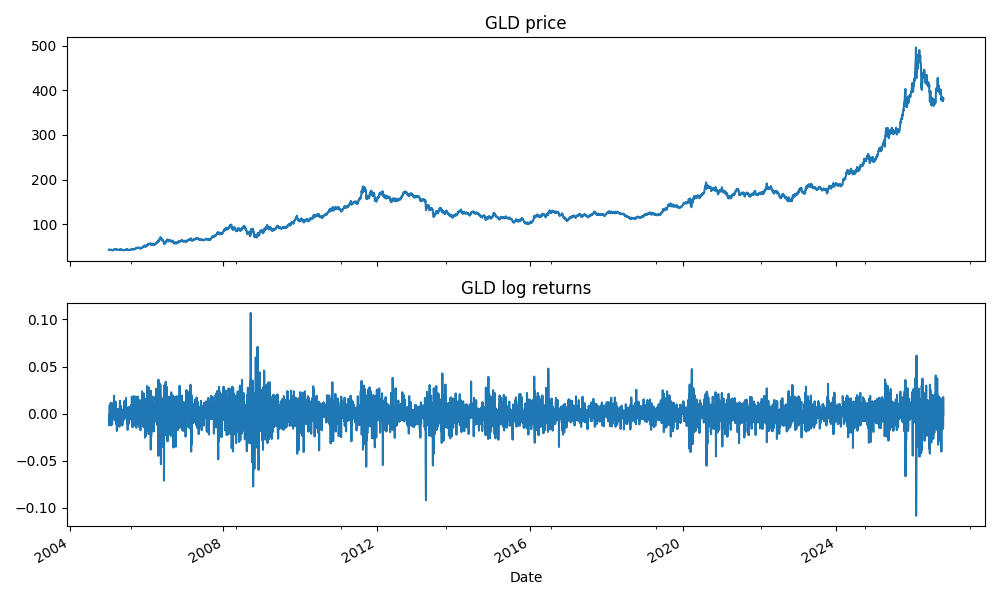
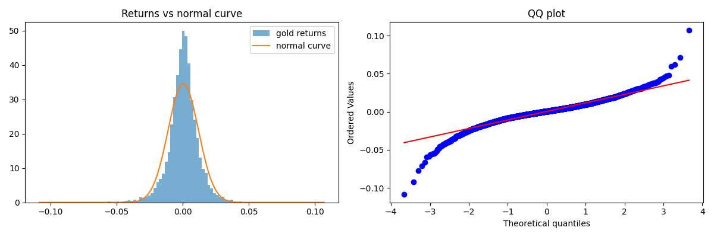
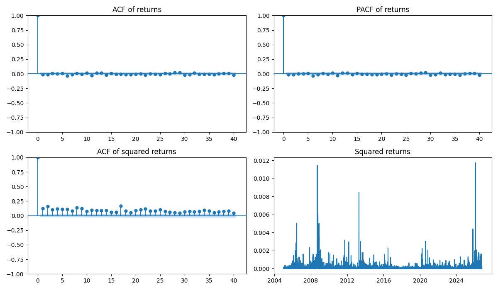
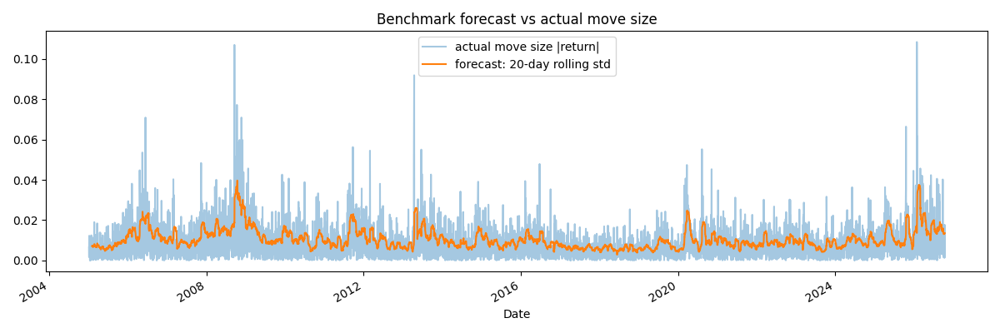
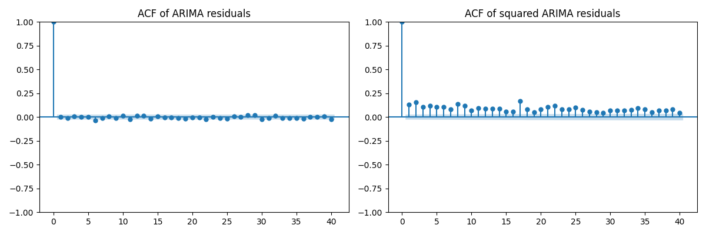
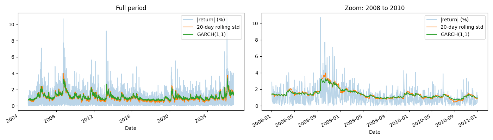
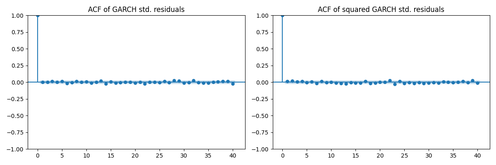
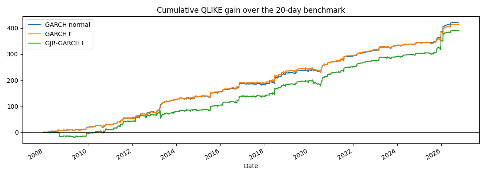
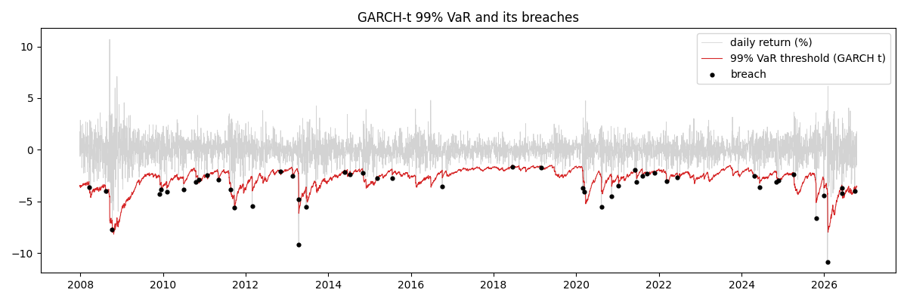

# Volatility Forecasting and VaR Backtesting of Gold (GLD) with ARIMA and GARCH

**Question:** Can GARCH-family models forecast the volatility of gold better than a simple 20-day rolling standard deviation, and does a Value at Risk (VaR) built on those forecasts hold up on data the models have not seen?

**Short answer:** Yes on both counts, with caveats. Every GARCH variant beat the rolling benchmark out of sample (QLIKE about 0.08 to 0.09 lower), and at 99% confidence the Student-t GARCH models passed the VaR backtest while the normal GARCH and the benchmark failed. No single model was best at every confidence level.

## Data

- **Asset:** SPDR Gold Shares ETF (GLD), daily adjusted close from Yahoo Finance via `yfinance`
- **Period:** 2005-01-03 to 2026-10-16 (5,482 prices, 5,481 daily log returns)
- **Returns:** `r_t = ln(P_t / P_{t-1})`, modelled in percent for the GARCH fits
- **Series type:** univariate. Every model uses only gold's own past returns.

| Statistic | Value |
|---|---|
| Mean daily return | 0.0398% |
| Daily standard deviation | 1.154% |
| Skewness | -0.45 |
| Excess kurtosis | 6.58 |
| Worst / best day | -10.8% / +10.7% |



## Project structure

```
volatility-risk-analysis/
├── data/        returns, walk-forward forecasts, mu and nu per refit
├── notebooks/
│   ├── 01_data_and_eda.ipynb     data, returns, stationarity, stylised facts
│   ├── 02_models.ipynb           benchmark, ARIMA, GARCH variants, walk-forward scoring
│   └── 03_var_backtest.ipynb     VaR, Kupiec test, independence test, breach analysis
├── outputs/     plots and result tables
└── README.md
```

## Method and findings

### 1. Exploratory analysis (notebook 01)

- **Prices are not stationary, returns are.** ADF p-value 0.989 for prices, effectively 0 for returns, so all models use returns.
- **Returns are fat-tailed.** Excess kurtosis is 6.58, and the QQ plot curves away from the normal line at both ends. The worst day is about 9.4 standard deviations from the mean.
- **Direction is hard to predict, size is not.** Ljung-Box on returns gives p = 0.18 (lag 10) and 0.26 (lag 20). On squared returns the statistics are 750 and 1,225 with p-values near zero. Volatility clusters.




### 2. Benchmark and ARIMA (notebook 02)



- **Benchmark:** 20-day rolling standard deviation, shifted by one day so each forecast uses only earlier data. The 20-day window is a convention (about one trading month).
- **ARIMA(1,0,1) on returns:** the AR and MA coefficients (0.36 and -0.38) are insignificant (p = 0.44 and 0.42) and cancel each other out. On the test period (2022-06-03 to 2026-10-16) its RMSE is 0.012362, against 0.012381 for a zero forecast.
- **Residuals:** they look like noise (Ljung-Box p = 0.31), but the squared residuals still show strong autocorrelation (Ljung-Box statistic 736 at lag 10). The ARCH-LM test gives 373.9 (p = 3e-74).

ARIMA models the level of returns, not how much they swing, so the volatility pattern passes straight through to its residuals.



### 3. GARCH models (notebook 02)

| Model | AIC | Notes |
|---|---|---|
| GARCH(1,1), normal | 15942.2 | alpha 0.060, beta 0.931, persistence 0.991 |
| GARCH(1,1), Student-t | 15585.0 | nu about 5.35 |
| GJR-GARCH(1,1), Student-t | 15564.2 | gamma = -0.039 (p < 0.0001) |

- **GARCH(1,1) removes the clustering ARIMA left behind.** ARCH-LM on standardised residuals drops from 373.9 (p = 3e-74) to 7.29 (p = 0.70).
- **Student-t fits far better than normal** (AIC lower by 357). Excess kurtosis of the normal model's standardised residuals is still 2.4.
- **GJR asymmetry is reversed relative to stocks.** gamma is negative, so a rally of a given size raises the next-day risk forecast more than a selloff of the same size (from a 1.2% starting level and a 3% move: 1.404% after a rise, 1.272% after a fall). I did not test why. Gold's safe-haven role is one possible explanation.
- **Small leftover effect in GJR-t.** Its ARCH-LM p-value is 0.0004 unclipped but 0.27 once standardised residuals are capped at ±4, so a few extreme days drive much of it. The lag-1 autocorrelation of its squared residuals is still visible.




### 4. Walk-forward evaluation (notebook 02)

Each model is fitted on the data before a date, used to forecast the next 20 trading days with parameters held fixed, then refitted. The first 750 days are used only for the initial fit. This gives **4,731 out-of-sample days (2007-12-27 to 2026-10-16)** from 237 refits.

Actual variance is proxied by the squared return, which is noisy for any single day but unbiased on average. Lower is better for both scores.

| Forecast | QLIKE | RMSE (variance) | QLIKE gain vs rolling |
|---|---|---|---|
| GARCH normal | 1.0604 | 3.8469 | +0.0886 |
| GARCH t | 1.0618 | 3.8490 | +0.0873 |
| GJR-GARCH t | 1.0665 | 3.8475 | +0.0825 |
| 20-day rolling std | 1.1490 | 3.9191 | 0 |

- All three GARCH variants beat the benchmark, and are close to each other. I ran no significance test on the differences between them, so I do not claim any variant is better than another.
- The QLIKE gain is positive in every period and model except GJR-t in 2008-2009 (-0.008). It was smallest in the 2008-2009 window (about 0.04), and larger in 2010-2013 and 2020-2026 (about 0.10 to 0.12).



### 5. VaR backtest (notebook 03)

One-day VaR for a long position, from `mu + sigma * q`, using the parameters in force at each refit. For Student-t the quantile is scaled by `sqrt((nu-2)/nu)` because the model's t is standardised to unit variance. The benchmark uses a zero mean and the normal quantile. A breach is a day when the return falls below the threshold.

Kupiec's test checks the breach count against the promised rate (237 expected at 95%, 47 at 99%, out of 4,731 days).

| Level | Model | Avg VaR | Breaches | Breach rate | Kupiec p |
|---|---|---|---|---|---|
| 95% | GARCH normal | 1.78% | 233 | 4.93% | 0.812 |
| 95% | GARCH t | 1.69% | 267 | 5.64% | 0.046 |
| 95% | GJR-GARCH t | 1.67% | 268 | 5.67% | 0.040 |
| 95% | 20-day rolling | 1.71% | 294 | 6.21% | 0.000 |
| 99% | GARCH normal | 2.53% | 78 | 1.65% | 0.000 |
| 99% | GARCH t | 2.79% | 50 | 1.06% | 0.697 |
| 99% | GJR-GARCH t | 2.75% | 54 | 1.14% | 0.339 |
| 99% | 20-day rolling | 2.42% | 108 | 2.28% | 0.000 |

- **At 99%, the Student-t models pass and the normal model fails.** The t-distribution did not improve the variance forecast, but it fixes the tail quantile, at the cost of a roughly 10% larger VaR.
- **At 95%, the pattern reverses.** The normal model is on target, and the t-models breach slightly too often (5.6 to 5.7%), a mild miss with borderline p-values (0.04 to 0.05).
- **The 20-day benchmark fails at both levels**, with a breach rate more than twice the promised rate at 99%.

**Breaches by period (99%):**

| Period | Days | Expected | Normal | GARCH t | GJR-t | 20-day |
|---|---|---|---|---|---|---|
| 2008-2009 | 508 | 5.1 | 6 | 5 | 7 | 8 |
| 2010-2013 | 1006 | 10.1 | 22 | 14 | 15 | 28 |
| 2014-2019 | 1510 | 15.1 | 20 | 8 | 12 | 29 |
| 2020-2021 | 505 | 5.0 | 13 | 10 | 9 | 17 |
| 2022-2026 | 1202 | 12.0 | 17 | 13 | 11 | 26 |

**Independence (Christoffersen):** at 99% every model passes (p from 0.145 to 0.559), but with about 50 breaches the test has little power. At 95%, GJR-GARCH t fails (P(breach after breach) = 10.1% against 5.4% after a calm day, p = 0.003); the other models pass.



The largest misses are single-day shocks out of calm periods (April 2013 and early 2026). No volatility model forecasts a surprise like that; the VaR line reacts the day after.

## Conclusions

1. Gold returns are close to unpredictable, but their volatility clusters, so a volatility model is needed. ARIMA adds nothing for returns and leaves the clustering in its residuals.
2. GARCH-family models forecast variance better than a 20-day rolling standard deviation over 19 out-of-sample years, with a consistent but modest gain.
3. Fat tails matter for VaR. Student-t versions passed the 99% frequency and independence tests, and the normal version did not.
4. GARCH-t is the best headline model in this study, because it passes 99% and only mildly overshoots at 95%. This is a judgement from the table above, which shows the trade-offs in full.
5. GJR's extra asymmetry term improved the in-sample fit, but not the out-of-sample variance scores, and it showed some breach clustering at 95%.

## Limitations

- One asset and one sample. Results for stocks or other assets may differ, and in particular the sign of the GJR asymmetry may not carry over.
- Models are refitted every 20 trading days, not daily.
- VaR is for a long position (loss when gold falls). A short position would use the upper tail.
- The squared return is a noisy proxy for actual variance.
- About 50 breaches at 99% give the Kupiec and independence tests limited power. Several tests were run, so borderline p-values (0.04 to 0.05) should not be over-read.
- The first fit uses 750 days of calm data (2005-2007), so early parameters were learned without a crisis in the sample.
- Explanations marked as possible in this README were not tested.

## Reproducing

1. Run the notebooks in order in Google Colab (or locally with Python 3.10+).
2. Dependencies: `pandas numpy matplotlib scipy statsmodels arch yfinance`
3. Notebook 02 saves the walk-forward forecasts and notebook 03 loads them, so keep the `data/` folder between the two.

## Tools

Python, pandas, statsmodels, arch, scipy, matplotlib, Google Colab.

---

*Author: Janindu Egalla.* [GitHub](https://github.com/JaninduI)
